# HYROX Tracker

A web app I made to follow my own 16-week HYROX plan, from a kick-off weekend on 26 Sep 2026 to race day on 15 Jan 2027 (HYROX Singles Open Men, goal 1:30:00). It runs on Firebase, works on a phone like an app (add it to the home screen) and keeps working offline at the gym.

Live at https://hyroxtraining.web.app (sign in with Google).

<p>
  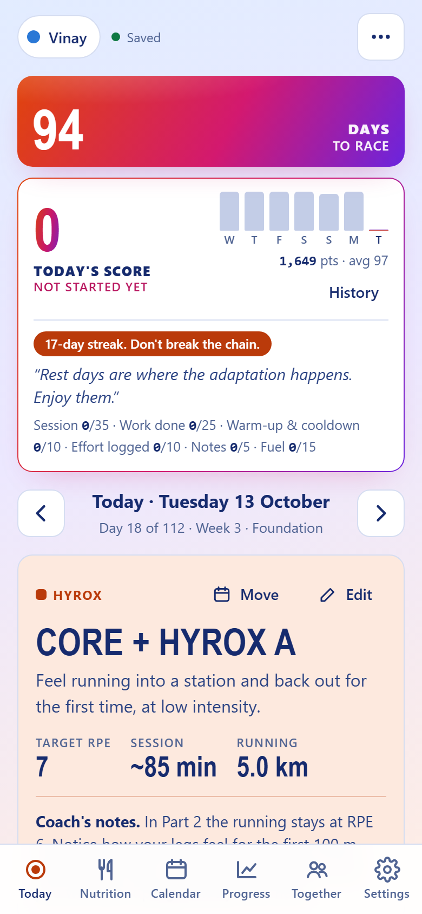
  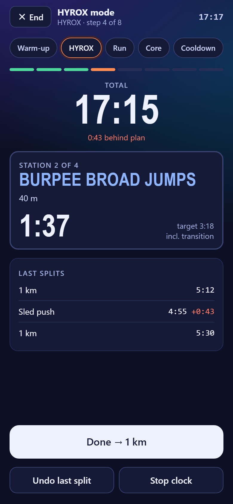
  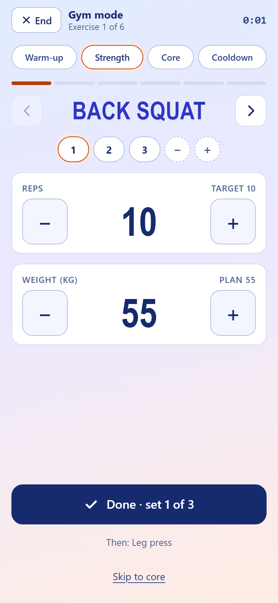
</p>

The screenshots use sample data: two and a half weeks of logged training on a test copy of the app.

## What it does

**The plan**
- 112 days built in (`public/plan-data.js`): week 0 is the kick-off weekend, then Foundation, Deload + benchmarks, Running + Strength Development, HYROX-Specific Conditioning, Race-Specific, Peak, Taper and Race week.
- Every day has its session: warm-up, main strength, running with target paces, HYROX work, accessory & core and cooldown.
- Benchmark tests through the plan (1 km and 5 km time trials, wall balls, SkiErg, row, sled push and pull, sandbag lunges, farmers carry) and three gates: a 5 km time trial, a half simulation and a full simulation.
- Paces come from the latest 1 km or 5 km test and race plans A, B, C and S give target splits for all 8 runs and 8 stations (Plan A finishes in 1:29:25).
- The plan can be edited in the app. Edits go to Firestore and override the built-in plan for everyone.

**Logging a day**
- Today page with sets, reps and kg per exercise, runs (distance, time, rep times, RPE), HYROX stations and the day's tests.
- Gym mode and HYROX mode: full-screen walk through the whole session, stage by stage. HYROX mode runs a race clock with one tap per split against the plan's targets.
- Rest timer, session timer, move exercises up and down, + / − sets, last time's weights, edit the warm-up and cooldown for one day or every day.
- Move a session to another day or catch up a missed one.
- Rest days with activities (walk, yoga, mobility and so on), session photos and a journal.
- "Are you sure?" when a value looks like a typing slip (a 1 km in 1:00, 400 kg on a set).

**Progress**
- Week, Running, Strength, Stations, Tests, Race (predicted finish and simulation history), Streaks, Badges, Journal and Body (check-ins, InBody import, niggles).
- A daily score out of 100 with motivation lines, a muscle map for each training day and achievements.

**Also**
- Nutrition: daily targets for calories, protein, carbs, fat and water from body details and the day's training (Mifflin-St Jeor with a factor per day type), logging per day and a race-week fuelling card.
- HYROX guide: every format and division with weights and the rulebook links.
- Training together: start a session with a training partner and everything you tick fills in their log too.
- Share card: a story or square image of a finished day.
- Private: only the member accounts listed in the Firebase rules can open it. An admin account can edit anyone's log and the plan; members see everyone's training.
- Look around: visitors can try the whole app on sample data (the button under Sign in, or `?demo`). It never touches Firebase and saves nothing.
- Classic and Colourful looks, light and dark, five text colours (all checked for contrast by `colours.py`).
- CSV export.

## Screenshots

**On a phone**

| Calendar | Nutrition | HYROX guide | Share card |
|---|---|---|---|
| 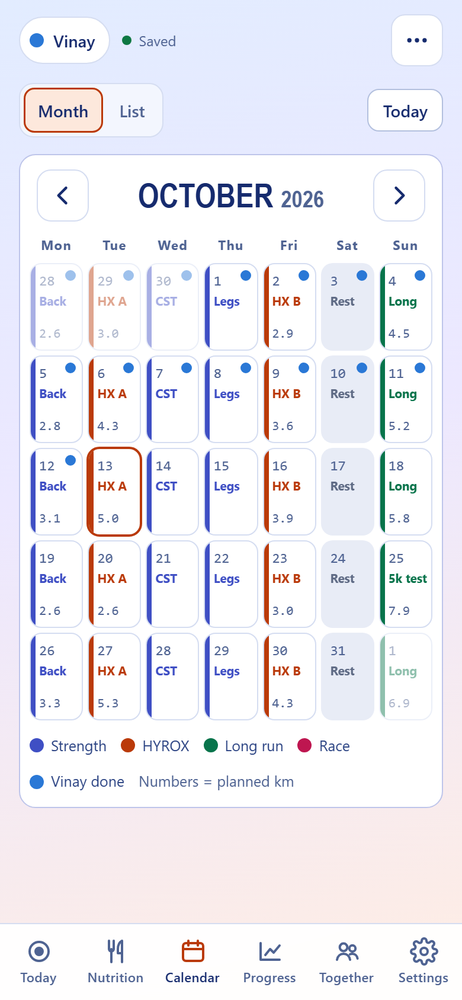 | 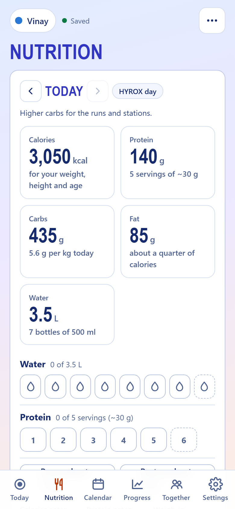 | 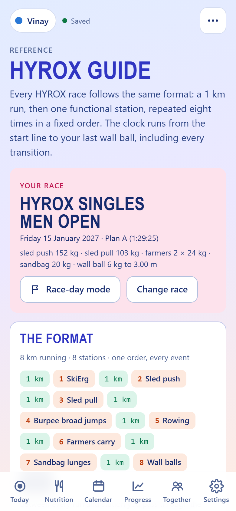 | 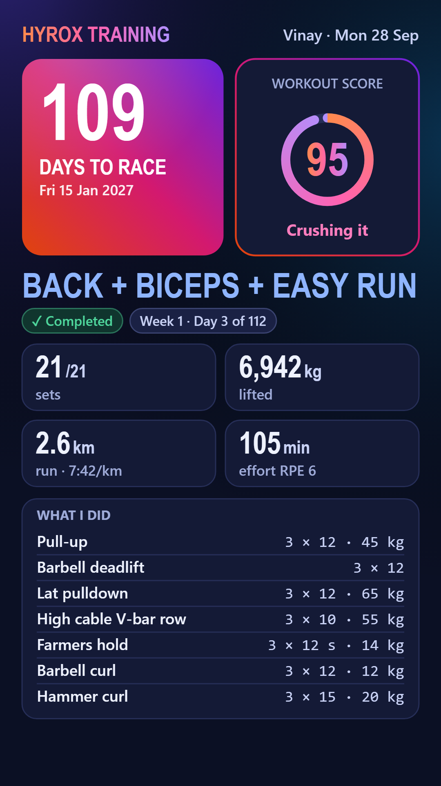 |

**On a computer**

Today

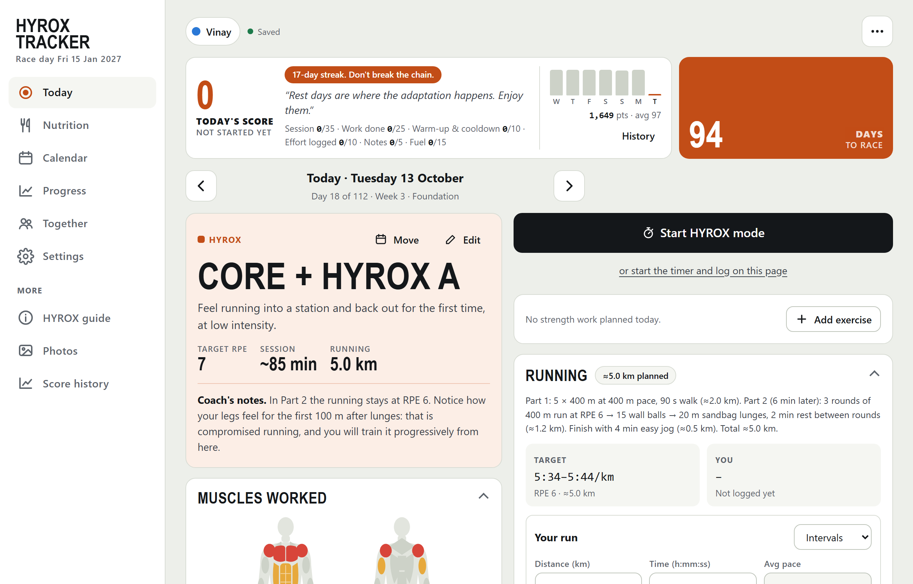

Progress: the week

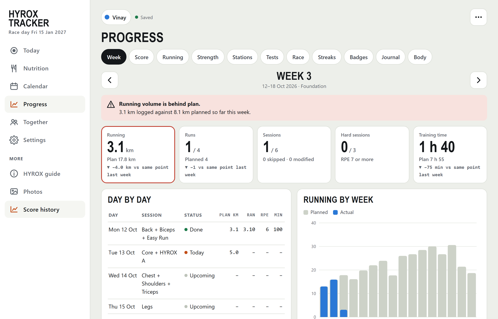

Progress: running

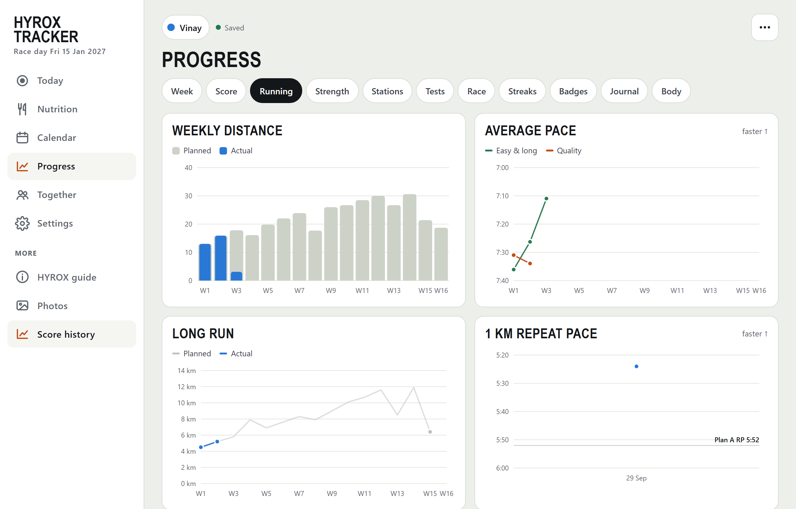

Progress: strength

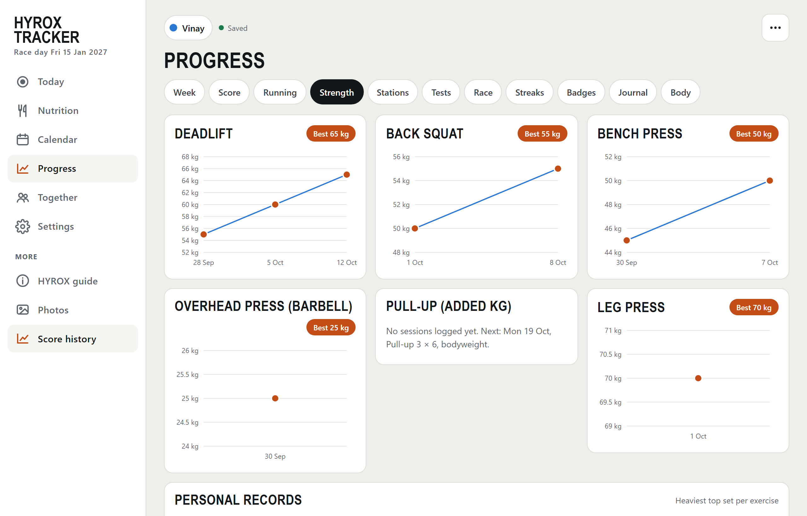

Progress: race-time predictor and target splits

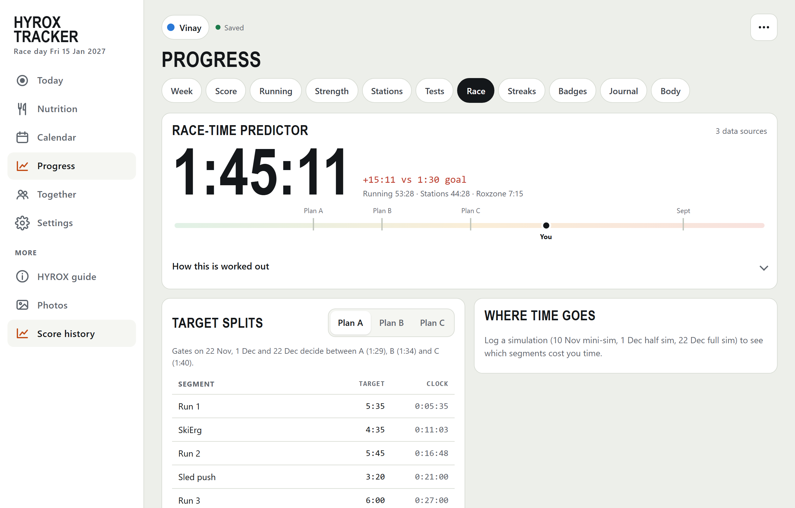

## How it's built

Plain JavaScript with no framework. Everything shares one global scope.

```
src/              the app, split by area (01-utilities.js ... 29-sign-in.js)
build_app.py      joins src/*.js in name order into public/app.js
public/           what gets deployed: index.html (markup and CSS), app.js, plan-data.js,
                  config.js (admin account ids), firebase-sdk.js, sw.js (offline cache), icons
build/            the Firebase wrapper, bundled into public/firebase-sdk.js with esbuild
firestore.rules   who can read and write what
storage.rules     photo uploads
redirect/         one page that forwards the project's default address to hyroxtraining.web.app
colours.py        the Colourful palettes and text colours, contrast-checked, written into index.html
test/             Playwright tests against a fake Firebase (test/mock-fbx.js) that enforces the same rules
START-HERE.html   step-by-step guide to putting the tracker on your own Firebase project
docs/notes.md     how the features work and how the data is stored
images/           screenshots for this README
```

Edit the files in `src/`, never `public/app.js`, then build:

```
python build_app.py
```

The build also checks that `APP_VERSION` (in `src/14-settings.js`) matches the cache name in `public/sw.js`. Bump both on every release so phones pick up the new version.

To rebuild the Firebase bundle:

```
cd build
npm install
npx esbuild fbx-entry.js --bundle --minify --format=iife --target=es2019 --outfile=../public/firebase-sdk.js
```

## Data

Firestore collections: `profiles`, `logs`, `bench` (test results), `weekly`, `niggles`, `plan_days`, `plan_weeks`, `plan_meta`, `together`, `body` and `myex`. Every document is `{ j: JSON.stringify(data) }`. A log's id is `<uid>_<date>`. Photos go to Cloud Storage at `photos/<uid>/<date>_...`, the original plus a small `_t.jpg` preview.

Only members can read: `members()` in `firestore.rules` and `storage.rules` lists their Firebase account ids (UIDs), so no email address is in the repo. You write your own documents and the admin (`admins()` in both rules files and `TRACKER_ADMINS` in `public/config.js`, keep all three the same) can write anyone's.

## Tests

Python and Playwright. Run each file from the repo folder:

```
pip install playwright
playwright install chromium
python test/run_today.py
```

Each file starts its own local server, opens the app with the fake Firebase and prints its checks. `run_photos.py` also needs a file over 25 MB:

```
head -c 27262976 /dev/urandom > test/too-big.jpg
```

`run_real.py` uses the real Firebase SDK and needs the app served on port 5055 with the Auth emulator on 9099.

## Deploy

```
npx firebase-tools deploy --project hyrox-tracker-6c078
```

This publishes `public/`, `redirect/` and both rules files.
